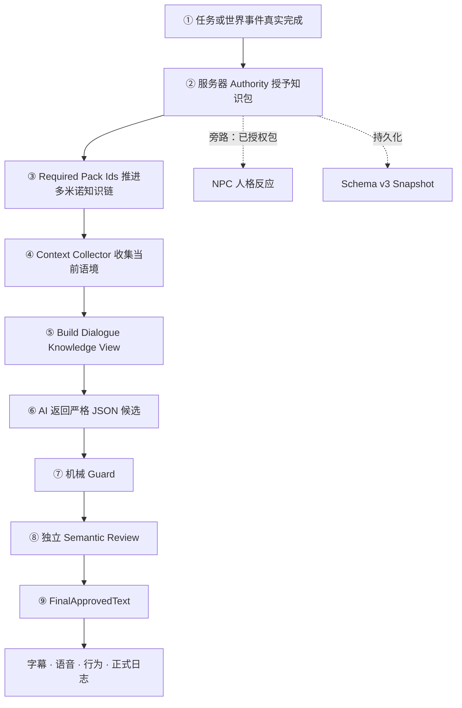
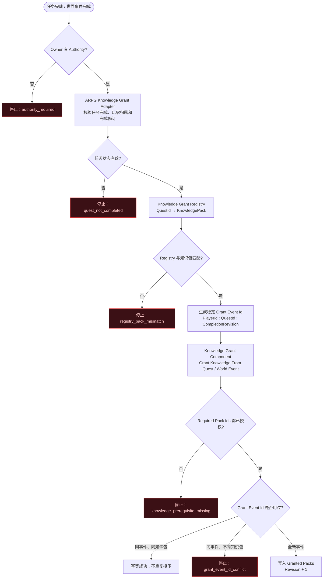
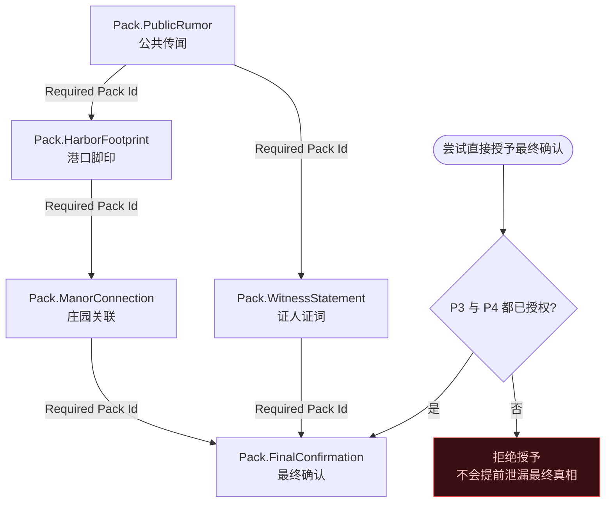
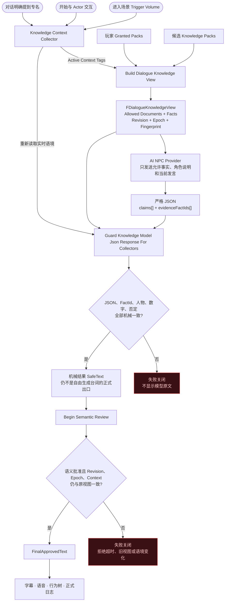
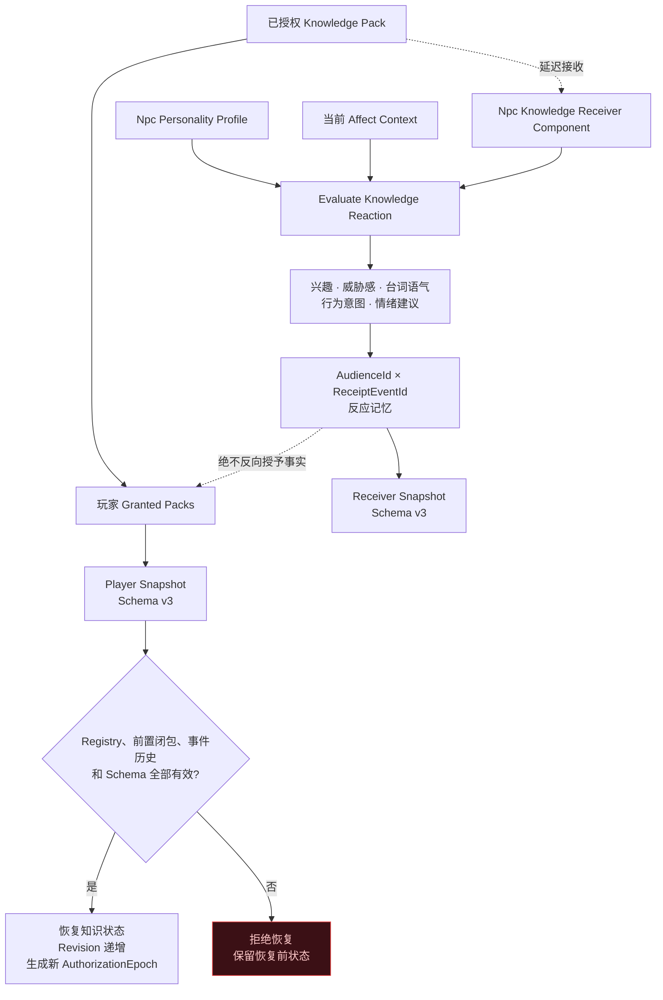

# 多米诺知识系统蓝图

这份蓝图把插件看成一套“不会提前倒下的多米诺系统”。它不要求你先懂 C++：先按编号看总览，再阅读四张分解图。

## 30 秒总览

一句话理解：**服务器决定哪块骨牌可以倒下，语境决定本轮照亮哪几块，双重守卫决定最终哪句话可以离开系统。**

## 图例

| 图形或连线 | 含义 |
|---|---|
| 圆角节点 | 一次事件、一个组件或一项结果 |
| 菱形节点 | 必须通过的判断门 |
| 实线箭头 | 正常执行顺序或数据流 |
| 虚线箭头 | 旁路通知、人格反应或存档，不会反向授予知识 |
| 红色失败节点 | 失败关闭：停止流程，不泄漏模型原文或未来事实 |

## 第一张蓝图：服务器如何推倒知识骨牌

对应 Unreal 中的任务完成事件、`ARPG Knowledge Grant Adapter Component`、固定 Registry 和玩家的 `Knowledge Grant Component`。

### 这一段每个部位做什么

| 多米诺比喻 | 插件部位 | 作用 |
|---|---|---|
| 推骨牌的手 | 服务器 Authority | 只有服务器能改变玩家知识状态 |
| 开始推动 | 任务/世界事件完成 | 表示事实已经在游戏世界中真实发生 |
| 固定轨道 | Knowledge Registry | 固定任务与知识包的对应关系 |
| 每次推动的编号 | Grant Event Id | 防止网络重试造成重复授予或事件换包 |
| 轨道管理员 | Knowledge Grant Component | 保存已授权知识，并检查前置、幂等和冲突 |

## 第二张蓝图：多米诺前置链如何阻止剧透

每个 `Knowledge Pack` 只保存当前阶段已经发生的原子事实。未来结论必须放进后续知识包。

这张图包含两种关系：

- **直线推进**：公共传闻 → 港口脚印 → 庄园关联。
- **分支汇合**：只有庄园关联和证人证词都获得后，最终确认才能倒下。

## 第三张蓝图：NPC 对话为什么不会直接相信 AI

知识已经授权，不代表任何场景都能使用。插件先求“已授权知识 ∩ 当前语境”，再把模型候选送过两道输出门。

### 两道门的区别

| 输出门 | 检查内容 | 不能替代什么 |
|---|---|---|
| Mechanical Guard | JSON 结构、证据 FactId、专名、数字、否定关系、实时语境 | 不能完整理解开放域自然语言含义 |
| Semantic Review | 候选句子是否真正得到允许事实支持 | 不能授予新知识，也不能返回替换台词 |

自由生成台词的正式消费端只能读取 `FinalApprovedText`。`SafeText` 是机械检查中间结果。

## 第四张蓝图：NPC 反应和存档为什么是旁路

NPC Receiver 保存的是“NPC 听到消息后的反应”，不是第三套知识授权。

虚线“绝不反向授予事实”是关键边界：NPC 可以表现得惊讶、谨慎或愤怒，但这些反应不能让玩家或其他 NPC 凭空获得知识。

## 新手照着接的最短顺序

1. 在玩家 Actor 或 PlayerState 上挂 `Knowledge Grant Component`。
2. 创建最少两个 `Knowledge Pack`：公共前提和后续发现。
3. 在后续包的 `Required Pack Ids` 中填写前置包 ID。
4. 任务完成后只在 Authority 侧调用授予节点。
5. 在玩家或对话协调 Actor 上挂 `Knowledge Context Collector Component`。
6. 对话前构建 `FDialogueKnowledgeView`。
7. 只把 `Allowed Documents` 和 `Facts` 发送给模型。
8. 模型返回严格 JSON 后先过 Mechanical Guard，再过 Semantic Review。
9. 字幕、语音和行为系统只消费 `FinalApprovedText`。
10. 最后再接 NPC Receiver 和 Schema v3 存档，不要把它们误当知识授权门。

## 常见接错位置

| 接错方式 | 为什么错 | 正确做法 |
|---|---|---|
| 把 Knowledge Grant Component 挂在每个 NPC 上 | 会把玩家知识拆成大量重复副本 | 挂在持久玩家 Actor 或 PlayerState |
| 客户端自己调用授予 | 客户端不能作为任务完成权威 | 由服务器任务系统或 Adapter 调用 |
| 一个包同时写公共前提和最终凶手 | 第一块倒下时就会剧透 | 按发生顺序拆成多个包 |
| 只根据 Context Tags 解锁知识 | 场景标签只能选择，不能授予 | 必须先完成任务授权，再进行语境筛选 |
| 直接显示模型文本 | 模型候选仍不可信 | 只显示 `FinalApprovedText` |
| 把 NPC 反应记忆当知识状态 | Receiver 只记录人格反应 | 玩家授权仍以 Knowledge Grant Component 为准 |

继续操作请阅读[新手从零接入教程](BEGINNER_GUIDE.md)；完整组件边界见[架构说明](ARCHITECTURE.md)。
