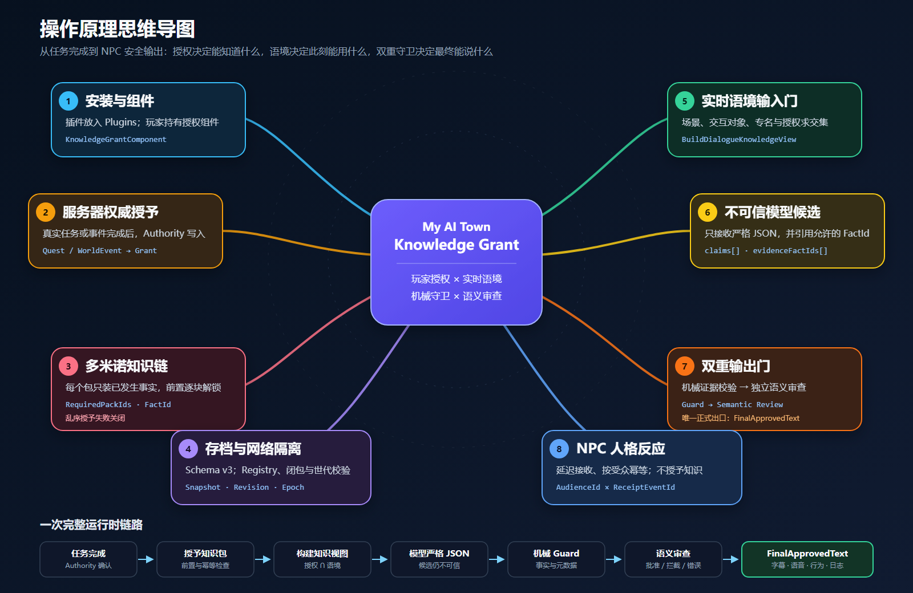
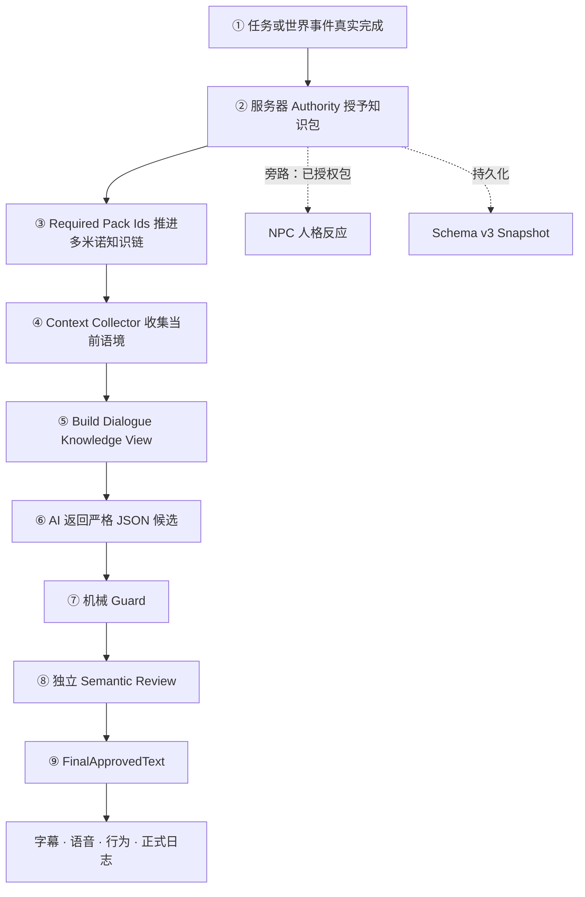
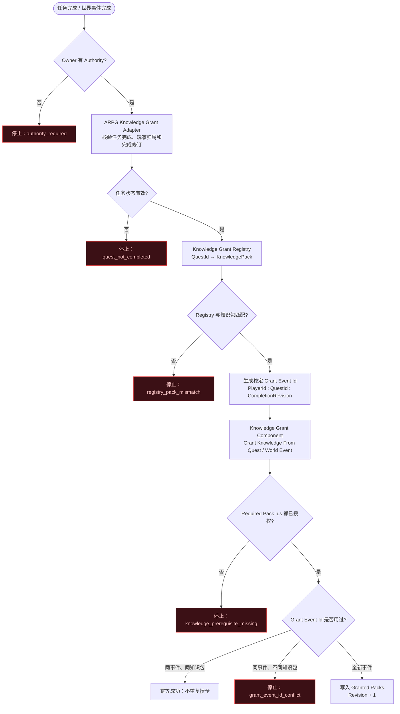
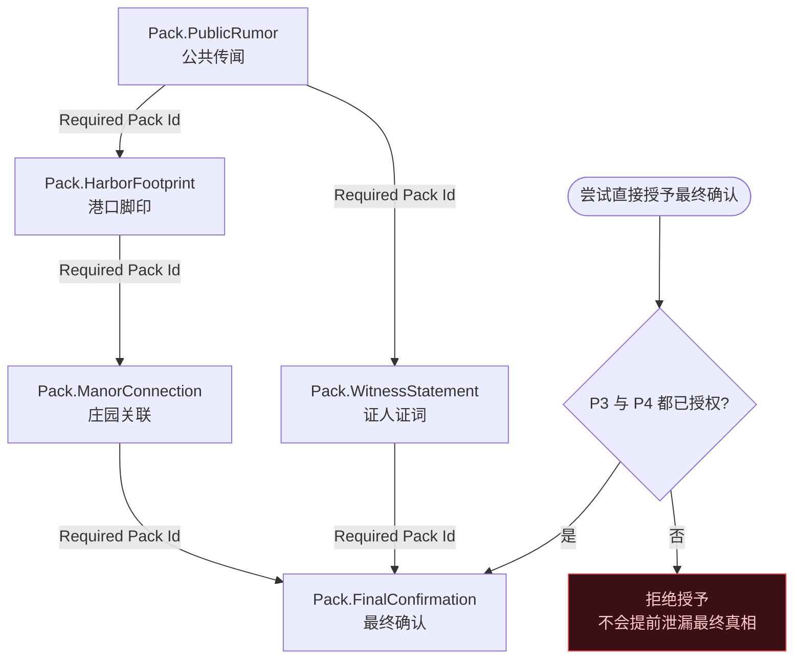
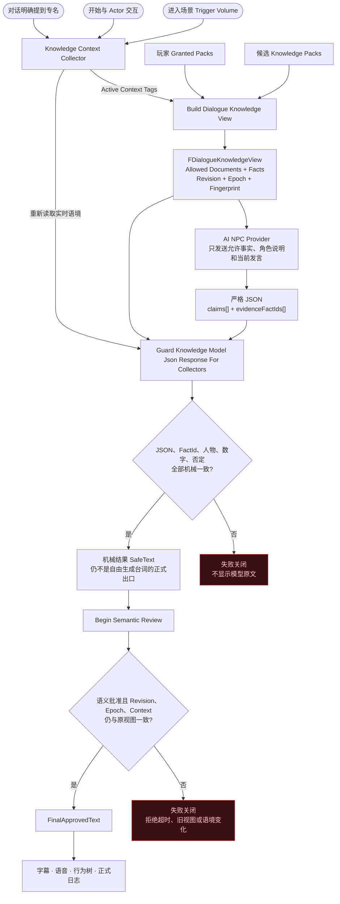
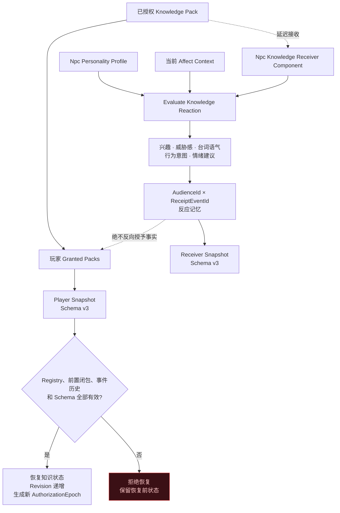

# My AI Town Knowledge Grant

**作者与版权人：xunyv**  
**许可证：MIT License**

专用于单机或联机 ARPG 的 Unreal Engine Runtime 插件。0.4.0 增加插件原生的玩家自带密钥（BYOK）AI-NPC 角色扮演入口：玩家可在运行时面板连接兼容 OpenAI Chat Completions 请求与响应格式的服务，每个挂载 `AI NPC Dialogue Component` 的 NPC 自动建立独立本地会话。API Key、Session 状态和最近的已批准对话只在当前游戏进程中使用，不由插件持久化；玩家明确同意后，角色说明、当轮授权事实和玩家当前发言会发送给对话服务，机械校验后的候选文本与允许事实会发送给配置的语义审查服务。自由生成的模型候选必须依次通过严格 JSON、机械事实守卫和语义审查，正式出口只消费 `FinalApprovedText`。

```text
服务器确认任务完成 → 固定注册表授予知识 → AI 生成严格 JSON
→ 机械事实守卫 → 独立语义审查 → FinalApprovedText
```

**新手从这里开始：[多米诺知识系统蓝图](#多米诺知识系统蓝图)** —— 四张流程图直接展示在本页下方，一次看清服务器授予、多米诺前置链、AI 对话双重输出门、NPC 反应与存档的完整链路与失败分支。

## 新手入口

第一次使用时，按下面的顺序阅读：

1. [操作原理思维导图](Docs/OPERATION_MINDMAP.md)：先看清任务授权、多米诺知识链、语境输入门和安全输出门之间的关系。
2. [多米诺知识系统蓝图](#多米诺知识系统蓝图)：已内嵌在本页下方，用四张流程图查看服务器授予、前置链、AI 双重输出门、NPC 反应和存档。
3. [新手从零接入教程](Docs/BEGINNER_GUIDE.md)：跟着编辑器操作创建 Data Asset、挂载组件、连接 Blueprint、配置 AI Provider 并排查错误。
4. [安装与接入检查单](INSTALL.md)：接入目标项目和发布前逐项核对。

核心知识授权、NPC 人格反应和机械守卫不要求 API Key。你可以先完成本地两骨牌流程，再接入 AI Provider 和语义审查服务。

[](Docs/OPERATION_MINDMAP.md)

> 如果图片未加载，请直接打开[操作原理思维导图页面](Docs/OPERATION_MINDMAP.md)。

## 多米诺知识系统蓝图

这份蓝图把插件看成一套“不会提前倒下的多米诺系统”。它不要求你先懂 C++：先按编号看总览，再阅读四张分解图。

### 30 秒总览



### 图例

| 图形或连线 | 含义 |
|---|---|
| 圆角节点 | 一次事件、一个组件或一项结果 |
| 菱形节点 | 必须通过的判断门 |
| 实线箭头 | 正常执行顺序或数据流 |
| 虚线箭头 | 旁路通知、人格反应或存档，不会反向授予知识 |
| 红色失败节点 | 失败关闭：停止流程，不泄漏模型原文或未来事实 |

### 第一张蓝图：服务器如何推倒知识骨牌

对应 Unreal 中的任务完成事件、`ARPG Knowledge Grant Adapter Component`、固定 Registry 和玩家的 `Knowledge Grant Component`。



#### 这一段每个部位做什么

| 多米诺比喻 | 插件部位 | 作用 |
|---|---|---|
| 推骨牌的手 | 服务器 Authority | 只有服务器能改变玩家知识状态 |
| 开始推动 | 任务/世界事件完成 | 表示事实已经在游戏世界中真实发生 |
| 固定轨道 | Knowledge Registry | 固定任务与知识包的对应关系 |
| 每次推动的编号 | Grant Event Id | 防止网络重试造成重复授予或事件换包 |
| 轨道管理员 | Knowledge Grant Component | 保存已授权知识，并检查前置、幂等和冲突 |

### 第二张蓝图：多米诺前置链如何阻止剧透

每个 `Knowledge Pack` 只保存当前阶段已经发生的原子事实。未来结论必须放进后续知识包。



这张图包含两种关系：

- **直线推进**：公共传闻 → 港口脚印 → 庄园关联。
- **分支汇合**：只有庄园关联和证人证词都获得后，最终确认才能倒下。

### 第三张蓝图：NPC 对话为什么不会直接相信 AI

知识已经授权，不代表任何场景都能使用。插件先求“已授权知识 ∩ 当前语境”，再把模型候选送过两道输出门。



#### 两道门的区别

| 输出门 | 检查内容 | 不能替代什么 |
|---|---|---|
| Mechanical Guard | JSON 结构、证据 FactId、专名、数字、否定关系、实时语境 | 不能完整理解开放域自然语言含义 |
| Semantic Review | 候选句子是否真正得到允许事实支持 | 不能授予新知识，也不能返回替换台词 |

自由生成台词的正式消费端只能读取 `FinalApprovedText`。`SafeText` 是机械检查中间结果。

### 第四张蓝图：NPC 反应和存档为什么是旁路

NPC Receiver 保存的是“NPC 听到消息后的反应”，不是第三套知识授权。



虚线“绝不反向授予事实”是关键边界：NPC 可以表现得惊讶、谨慎或愤怒，但这些反应不能让玩家或其他 NPC 凭空获得知识。

### 新手照着接的最短顺序

1. 在玩家 Actor 或 PlayerState 上挂 `Knowledge Grant Component`。
2. 创建最少两个 `Knowledge Pack`：公共前提和后续发现。
3. 在后续包的 `Required Pack Ids` 中填写前置包 ID。
4. 任务完成后只在 Authority 侧调用授予节点。
5. 在玩家或对话协调 Actor 上挂 `Knowledge Context Collector Component`。
6. 对话前构建 `FDialogueKnowledgeView`。
7. 只把 `Allowed Documents` 和 `Facts` 发送给模型。
8. 模型返回严格 JSON 后先过 Mechanical Guard，再过 Semantic Review。
9. 字幕、语音和行为系统只消费 `FinalApprovedText`。
10. 最后再接 NPC Receiver 和 Schema v3 存档，不要把它们误当知识授权门。

### 常见接错位置

| 接错方式 | 为什么错 | 正确做法 |
|---|---|---|
| 把 Knowledge Grant Component 挂在每个 NPC 上 | 会把玩家知识拆成大量重复副本 | 挂在持久玩家 Actor 或 PlayerState |
| 客户端自己调用授予 | 客户端不能作为任务完成权威 | 由服务器任务系统或 Adapter 调用 |
| 一个包同时写公共前提和最终凶手 | 第一块倒下时就会剧透 | 按发生顺序拆成多个包 |
| 只根据 Context Tags 解锁知识 | 场景标签只能选择，不能授予 | 必须先完成任务授权，再进行语境筛选 |
| 直接显示模型文本 | 模型候选仍不可信 | 只显示 `FinalApprovedText` |
| 把 NPC 反应记忆当知识状态 | Receiver 只记录人格反应 | 玩家授权仍以 Knowledge Grant Component 为准 |

继续操作请阅读[新手从零接入教程](Docs/BEGINNER_GUIDE.md)；完整组件边界见[架构说明](Docs/ARCHITECTURE.md)。

## 开源许可

本项目由 **xunyv** 以 [MIT License](LICENSE) 开源。允许个人和组织免费使用、复制、修改、合并、发布、分发、再许可及销售软件副本；分发软件或其重要部分时，必须保留原版权声明与 MIT 许可声明。商标、第三方资产及 Unreal Engine 本身不因本许可证获得授权，仍分别受其权利人的条款约束。

公开仓库必须保留 `LICENSE`。`NOTICE` 仅提供项目归属和 Unreal Engine 商标说明，并非 MIT 的附加许可条件。欢迎提交 Issue 与 Pull Request；安全问题请避免公开披露敏感利用细节，并通过仓库维护者提供的私密联系方式报告。

## 安装

将 `MyAiTownKnowledgeGrant` 整个目录复制到 Unreal 项目的 `Plugins/` 下，重新生成项目文件并编译。插件只使用 UE 内置的 GameplayTags、HTTP、JSON、UMG 和 Slate 模块，不依赖第三方模型 SDK 或数据库。

`0.4.0` 源码已通过 UE 5.7.4 / Win64 隔离 BuildPlugin 验证；二进制包以仓库实际发布的 GitHub Release 为准。安装、宿主发布前检查与已知边界见 [INSTALL.md](INSTALL.md)，官方构建清单见 [RELEASE_MANIFEST.md](RELEASE_MANIFEST.md)。其他引擎版本或平台应使用源码重新编译。

单机 ARPG 推荐把 `Knowledge Grant Component` 挂在跨关卡可恢复的玩家 Actor 或 PlayerState 上；联机 ARPG 推荐挂在服务器权威且可复制的 PlayerState 上。不要挂在每个 NPC 上。

正式任务授予推荐再挂载 `ARPG Knowledge Grant Adapter Component`，由服务器任务系统实现 `ARPG Quest Authority Provider`，并通过固定 `ARPG Knowledge Grant Registry` 解析 `QuestId → KnowledgePack`。适配器核验任务完成状态与玩家归属、拒绝调试和乱序事件、在服务器生成 GrantEventId，并广播审计/持久化通知。完整合同见 [Docs/ARPG_INTEGRATION.md](Docs/ARPG_INTEGRATION.md)。

## 玩家在哪里输入 AI API

项目可从暂停菜单或 AI 设置页调用蓝图节点 `Show AI NPC Provider Settings`。插件会直接创建原生运行时面板，玩家在其中填写：厂商名称、完整 Chat Completions URL、模型名称和 API Key，并勾选传输同意。Key 仅在运行期间用于内存配置和请求的 Authorization Header，不写入 ini、SaveGame、Data Asset 或插件日志。点击 `Clear credentials` 后插件会清除 Subsystem 中的凭据并拒绝新的请求，但无法撤回已经发出的请求，也不承诺对引擎和系统底层内存执行安全擦除。

编辑器的 `Project Settings → Plugins → AI NPC Roleplay` 只保存非敏感默认值和披露文本，不保存 Key。默认开启 `bRequireIndependentSemanticReview`：语义审查通道与对话通道的 URL 和模型完全相同时配置会被拒绝（`review_provider_must_be_independent`），面板也会禁用“共用同一厂商”勾选，避免同一模型自审自批。每个 NPC 挂一个 `AI NPC Dialogue Component`；组件在 `BeginPlay` 自动创建独立本地 Session，通过共享 Provider 网关发请求，避免为每名 NPC 复制密钥或 HTTP 服务。完整接入、隐私边界和蓝图步骤见 [Docs/AI_NPC_PROVIDER.md](Docs/AI_NPC_PROVIDER.md)。

玩家 BYOK 适用于单机游戏和本地 listen-server。正式多人专用服务器不应索取、复制或信任客户端 API Key；项目应在服务器进程配置自有 Provider，并由服务器承担费用、提示词、审计和隐私告知。远程地址必须使用 HTTPS；只有精确的 loopback 主机（`localhost`、`[::1]`、`127.0.0.0/8`）可以使用 HTTP，以便连接本机模型服务，形如 `http://localhost.com` 的前缀仿冒地址按远程处理并强制 HTTPS。

完整组件图、单轮数据流、失败策略与本地/云端边界见 [Docs/ARCHITECTURE.md](Docs/ARCHITECTURE.md)。

## 蓝图接入

1. 创建 `Knowledge Pack` Data Asset，填写唯一的 `Pack Id`，并在 `Source Quest Id` 与 `Source World Event Id` 中二选一。未来事实应拆到后续包，用 `Required Pack Ids` 串成因果链。
2. 已发生的世界事件调用 `Grant Knowledge From World Event`；最终任务结算仍可调用 `Grant Knowledge From Quest`。乱序触发会返回 `knowledge_prerequisite_missing`。
3. `Grant Event Id` 必须稳定且唯一，例如 `PlayerId:QuestId:CompletionRevision`。插件会裁剪首尾空白，并记录规范化的 `EventId → PackId`；同一事件换包会返回 `grant_event_id_conflict`。
4. 所有 NPC 的对话入口在组装 AI 上下文前调用 `Build Dialogue Knowledge View`，传入当前说话玩家的组件、候选知识包和当前语境标记。
5. 只在 Authority 侧把视图中的 `Allowed Documents` 交给后续提示词或 RAG 层。结果为空时不添加任何知识提示；非 Authority 客户端调用会得到 `authority_required`。
6. 每个 `Knowledge Document` 至少配置一个原子 `Knowledge Fact`，包含稳定 `Fact Id`、事实陈述、规范专名、规范数字和否定状态。模型必须输出下文定义的严格 JSON；把原始 JSON、同一个知识视图、实际 `Knowledge Context Collector` 组件和可信策略交给 `Guard Knowledge Model Json Response For Collectors`。该节点在内部读取当轮实时 Tags、完成解析与证据引用/元数据一致性检查，不向蓝图暴露未校验 claims。只有需要自定义语境来源时才使用带显式 `Current Active Context Tags` 的底层入口。
7. 对自由生成台词启用 `Knowledge Semantic Review Component`：把机械 Guard 结果提交给 `Begin Semantic Review`。内置 AI-NPC 路径可自动转交已配置的审查 Provider；自定义接入则由宿主监听请求并调用自己的云 API、本地模型或语义服务，再把只能批准/拦截的结构化响应交回 `Complete Semantic Review`。组件会在异步返回后重新验证授权和实时语境。
8. 启用语义审查时，字幕、语音、行为系统和正式日志只能消费 `FinalApprovedText`；`SafeText` 只是机械校验中间结果。审查超时、错误、覆盖不完整或视图过期全部失败关闭。接口合同见 [Docs/SEMANTIC_REVIEW_API.md](Docs/SEMANTIC_REVIEW_API.md)。

`FDialogueKnowledgeView` 是一次对话的唯一知识快照，包含语境标记、玩家授权修订号、授权世代、允许文档、排除原因和 CRC32 一致性校验值。输出门会把视图语境与调用方提供的当轮实时 Tags 做精确比较，并重新核对当前授权 Revision 与 `AuthorizationEpoch`。切场景、恢复/替换授权状态或改写视图后，分别以 `dialogue_view_context_changed`、`dialogue_view_stale` / `dialogue_view_authorization_changed`、`dialogue_view_tampered` 失败关闭。CRC32 只发现意外改写，不是密码学签名。

`FKnowledgeDialogueGuardResult::Outcome` 明确区分 `Invalid`、`Allowed`、`PartiallyAllowed` 和 `Blocked`。`bOk=true` 只表示至少有一条经过机械检查的事实陈述可用；全部陈述被拦时 `bOk=false`、`Outcome=Blocked`，可信兜底仍可通过 `SafeText` 返回。未启用语义审查的受控模板路径可按 `Outcome` 消费机械结果；自由生成台词启用语义审查后只能消费 `FinalApprovedText`。

每条候选陈述都按知识性内容处理；候选结构中不再存在可由模型设置的 `bKnowledgeBearing=false` 旁路。安全兜底来自宿主预先创建的可信 `Knowledge Dialogue Guard Policy` 资产，调用方不能把原始候选文本临时作为兜底传入。策略还维护项目受保护专名/书写数字词表，用来发现文本中出现但 claim 元数据未申报的词。策略支持整段失败（默认 `AllOrNothing`）和逐条保留（`PerClaim`）。

## 场景与专属名词标记信息库

插件使用 UE 原生 Gameplay Tags。每个 `Knowledge Pack` 都可以填写 `Activation Tags`。项目应根据自己的世界设定注册稳定标签，例如：

- `Knowledge.Context.Scene.<SceneId>`：场景信息库；
- `Knowledge.Context.Entity.<EntityId>`：人物、组织或阵营信息库；
- `Knowledge.Context.Item.<ItemId>`：道具信息库。

项目可以在 Project Settings → Gameplay Tags 中添加城市、人物、阵营、道具、年代和组织等专属名词标记。README 不绑定任何演示任务或世界观专名。

完整运行流程：

1. 为一组资料创建 `Knowledge Pack`，把资料写入 `Documents`。
2. 在 `Activation Tags` 填入能够激活这个信息库的场景或专名标记。空容器表示全局资料；填写多个标记时，当前语境匹配任意一个即可激活。
3. 任务完成或世界事件真实发生后，Authority 调用 `Grant Knowledge From Quest` / `Grant Knowledge From World Event`。标记只选择信息库，绝不代替任务授权。
4. NPC 对话开始时，宿主收集当前语境标记：所在 Scene/Volume、正在交互的 Actor、对话提到的专名、NPC 自身身份等，组合成 `Active Context Tags`。
5. 调用 `Build Dialogue Knowledge View`。插件生成：已授权知识包 ∩ 当前标记激活的信息库，并把本次作用域固化在视图中。
6. 把视图的 `Allowed Documents` 及其 `Facts` 送入模型；模型按原子陈述返回严格 JSON：`{"claims":[{"claimId":"...","text":"...","evidenceFactIds":["..."],"claimedEntities":["..."],"claimedNumbers":["..."],"negated":false}]}`。根对象和 claim 均禁止额外字段。
7. 调用 `Guard Knowledge Model Json Response For Collectors`，传入模型原始 JSON、同一个视图、实际收集器组件和宿主可信策略资产；插件内部从收集器读取当轮实时 Tags。空载荷、畸形 JSON、错误类型、空或重复 ID、超限数组与超长文本均失败关闭；只有内部解析并通过 `Guard Dialogue Knowledge View` 后才返回机械 `SafeText`。
8. 将机械结果交给 `Knowledge Semantic Review Component`。外部审查器只能返回批准、拦截或错误，不能注入替换台词；等待期间若授权或语境改变，旧响应失败关闭。
9. 字幕、语音、行为树和后台日志只能消费返回的 `FinalApprovedText`。被锁定、属于错误场景、没有证据、语义审查不通过或审查服务不可用的陈述全部失败关闭。

最终可见知识公式：

`NPC 最终可说的信息 = 玩家已解锁资料 ∩ 当前场景/专名标记激活资料 ∩ 机械证据校验通过 ∩ 语义审查批准`

本插件采用“玩家授权 × 语境”模型。`Npc Knowledge Receiver Component` 只保存 NPC 收到消息后的确定性人格反应与情绪建议，不是知识授权门，也不参与上式；因此不会产生 `NPC × 玩家` 的知识副本。Reaction receipt 使用稳定 `AudienceId × ReceiptEventId` 隔离共享 NPC 面向不同玩家的反应记忆，但这些记录仍不授予任何事实。若项目确实要求每名 NPC 对每名玩家拥有独立事实记忆，应在宿主层另建有界记忆系统，而不能把 Receiver 的反应快照误当授权状态。

当多个信息库都已经授权时，当前语境只激活标签匹配的资料；尚未真实发生的事件即使标签匹配，也不能进入对话上下文。

这条链路与 GAS 的 `GiveAbility` 类似：任务系统授予玩家一个持久能力；区别是这里授予的是对话资料访问权。`BlueprintAuthorityOnly` 用于明确节点意图，运行时还会再次检查 Owner 是否具有 Authority。

### 关卡语境收集组件

把 `Knowledge Context Collector Component` 挂到玩家、PlayerState 或对话协调 Actor。它只选择当前相关的信息库，不授予知识：

1. Trigger Volume 的 `BeginOverlap` 调用 `Enter Scene Context`，以该 Volume 为 `Source` 并传入场景 Tags；`EndOverlap` 调用 `Exit Scene Context`。多个重叠 Volume 的 Tags 会合并，同一 Source 再次进入会替换自己的旧 Tags。
2. 开始交互时调用 `Set Interaction Context`，以交互 Actor 为 Source；切换目标会替换旧交互 Tags。结束交互调用 `Clear Interaction Context`，旧 Actor 的迟到清理事件不会清除新目标。
3. 对话适配器识别到明确专名后调用 `Set Explicit Mention Context`；每个对话轮次结束时调用 `Clear Explicit Mention Context`。
4. 模型调用前用 `Get Active Context Tags` 构建 `Build Dialogue Knowledge View`；模型返回后把同一个收集器组件交给 `Guard Knowledge Model Json Response For Collectors`，由插件内部重新读取实时 Tags。切场景、换交互对象或改变专名后，旧视图会被代码以 `dialogue_view_context_changed` 拒绝，宿主随后重新构建视图。收集器是输入门与输出门的共同事实源，调用方不再手写“当前 Tags”。

`Reset All Contexts` 用于关卡切换、玩家重生或对话会话强制结束。组件用弱引用跟踪来源；已销毁的 Volume/Actor 不会继续贡献 Tags。

## NPC 人格反应

1. 为 NPC 创建 `Npc Personality Profile` Data Asset，配置共情、好奇、谨慎、秩序忠诚和攻击性。这些是稳定人格，不会被一次消息永久改写。
2. 在知识文档中配置威胁、新闻性、道德侵犯、秩序影响和主题标签。
3. 给需要记住消息反应的 NPC 挂载 `Npc Knowledge Receiver Component` 并指定人格资产。
4. NPC 即将与玩家发生相关对话时，在 Authority 侧调用 `Receive Unlocked Knowledge Pack`。这是延迟接收：任务完成时不遍历全世界 NPC。
5. 节点返回兴趣、认可、感知威胁、反应强度、台词语气、行为意图，以及可选情绪系统可消费的有界建议量。

`FNpcAffectContext` 只接受当前心境和激活态的语义输入；插件本身不依赖 `AIaffect-core`。若项目已有情绪系统，可以把它映射到该输入，并自行消费 `SuggestedValenceDelta` / `SuggestedArousalDelta`。

## 存档与复制

- 组件状态自动复制，但仅同步给拥有该组件的连接（`COND_OwnerOnly`）：其他客户端不会收到玩家的授权包与 `ProcessedGrants` 授予历史，任务进度和稳定玩家 ID 不随网络广播。授予和恢复只能在 Authority 上执行。
- 存档时调用 `Create Snapshot`，传入项目当前的稳定 `Pack Registry Version`，再把返回结构写入 SaveGame 或后端。
- 载入时在服务端调用 `Restore Snapshot`，同时传入当前注册的全部 `Knowledge Pack` 和期望的注册表版本。
- 当前知识快照 Schema 为 v3。恢复会拒绝旧 Schema、注册表版本不匹配、未注册包、缺失前置闭包、循环前置、伪造 Tags、无对应事件历史的已授予包，以及指向未授权包的事件记录；授权 Tags 会根据注册包重新派生。
- 恢复成功后 Revision 必定大于当前状态与快照中的 Revision，并生成新的 `AuthorizationEpoch`，因此恢复前的全部对话视图都会失效。
- v1/v2 快照不会静默迁移。项目若需要保留旧存档，应在宿主层显式迁移并重新生成 v3 快照。
- Receiver 反应快照为 Schema v3；每条 receipt 必须包含规范化的 `AudienceId`，反应分数、语气、行为意图和建议增量都必须落在插件定义范围。旧 v1/v2 快照失败关闭。恢复成功会广播 `On Reaction Memory Restored`，宿主可直接刷新表现。
- `ProcessedGrants` 保存规范化的 `GrantEventId → PackId`，防止重放和事件 ID 换包。
- 撤销使用 `Revoke Knowledge Pack`，需要传入当前注册包；会移除该包的授权与历史并重新派生 Tags。若仍有已授权包依赖它，返回 `pack_has_dependents`，必须先撤销依赖者。
- `Max Processed Grant Records` 与 Receiver 的 `Max Receipt Records` 默认 `0`（不限）；设置为正数时，超出上限返回 `grant_history_full` / `receipt_history_full`，失败关闭而不是静默丢弃历史。

## 验收

在 Unreal Automation 中运行：

- `MyAiTown.KnowledgeGrant.Runtime.QuestFlow`
- `MyAiTown.KnowledgeGrant.Runtime.Validation`
- `MyAiTown.KnowledgeGrant.Runtime.CausalChain`
- `MyAiTown.KnowledgeGrant.Runtime.DialogueGuard`
- `MyAiTown.KnowledgeGrant.Runtime.ModelAdapterContract`
- `MyAiTown.KnowledgeGrant.Runtime.SnapshotConsistency`
- `MyAiTown.KnowledgeGrant.Runtime.ContextTagLibraries`
- `MyAiTown.KnowledgeGrant.Runtime.ContextCollector`
- `MyAiTown.KnowledgeGrant.Runtime.SemanticReviewContract`
- `MyAiTown.KnowledgeGrant.Runtime.AiNpcProviderContract`
- `MyAiTown.KnowledgeGrant.Reaction.PersonalityAndAffect`
- `MyAiTown.KnowledgeGrant.Reaction.DelayedReceipt`
- `KnowledgeGrantHost.Network.FKnowledgeAuthorityIsolationNetworkTest.AuthorityAndPlayerIsolation`（宿主 Editor 专用）

自动化测试覆盖：公共任务常识可用但未来细节不可用、后续骨牌乱序拒绝、每次事件只新增当前事实、任务包兼容、事件幂等、事件 ID 换包冲突、注册表一致的快照恢复、跨版本/伪造/缺前置/循环/缺事件历史快照拒绝、无效但未授权注册包不阻塞恢复、语境隔离与 Collector 取实时 Tags、空证据拦截、整段/逐条策略、陈旧/篡改视图拒绝、错专名、漏报受保护专名、错数字、正负号与小数、中文书写数字、反转否定、畸形/越界模型 JSON、撤销依赖保护与可选历史上限，以及同一事实结合不同人格形成不同反应。Receiver 测试证明共享 NPC 可分别记录玩家 A/B 的同名事件、单个玩家内部仍幂等、非 Authority 拒绝、受众/事件 ID 规范化、事件换包冲突、伪造越界反应拒绝和可选 receipt 上限。宿主演示还验证清空后 HUD 不保留旧反应、恢复后从 Receiver 快照重建可见反应。宿主网络测试另以专用服务器和两个真实 PIE 客户端验证：玩家 A 的授权复制后不会出现在玩家 B，客户端直接授予与恢复均返回 `authority_required` 且不改变修订号。

本插件已在 Unreal Engine 5.7.4 完成隔离 BuildPlugin：UHT WarningsAsErrors、Editor Development、Game Development 与 Game Shipping 均通过。插件 Automation 12/12，隔离 ARPG 宿主 5/5；共执行 17 项，0 失败。完整结果和网络测试的框架警告说明见 [VALIDATION.md](VALIDATION.md)。

没有 Unreal 工具链时可先运行 `node Scripts/validate-plugin.mjs`。它只验证插件结构和关键边界，不能替代 UnrealHeaderTool、C++ 编译或 Automation Test。

## 第一版边界

核心知识授权与机械守卫不依赖模型或网络；可选的 `AI NPC Provider Subsystem` 会调用玩家或项目配置的 OpenAI-compatible Chat Completions 服务，并可调用单独配置的语义审查服务。插件不扫描项目文件、不负责 Token 预算，也不实现向量检索。内置机械适配器严格解析 JSON，并执行“证据引用与元数据一致性门”；语义审查组件提供异步协议、超时和旧视图复验，既可接入内置 Provider，也可由宿主连接其他本地模型或云端服务。机械层不能证明开放域自然语言完整蕴含所引用事实，因此关键剧情仍推荐宿主控制的规范事实模板。若宿主绕过机械 Guard 或最终语义出口，插件无法提供防泄漏保证。

本阶段故意移除了旧的 `Resolve All Unlocked Knowledge`、`Resolve Knowledge For Context Tags`、`Filter Grounded Dialogue` 和 `Filter Grounded Dialogue For Context Tags` 蓝图入口。这是一次失败关闭的破坏性 API 迁移：旧蓝图必须改为“构建视图 → 生成候选 → 守卫视图”，否则应在编译时暴露缺失节点，而不是静默绕过语境。

如果任务资料属于必须防止客户端提前读取的剧情秘密，不要把明文 Data Asset 烘焙进客户端包；应由服务器或受控后端保存正文。本插件的 Authority 门保护运行时解析链，不承诺对已随客户端发布的资产提供反拆包保密。

本插件只面向 ARPG 项目内的运行时知识授权。它不实现跨服授权账本、服务器迁移、服务端正文分发、NPC 全局持久身份、运营审计数据库或无限期去重历史压缩。`ProcessedGrants` 与 Receiver receipts 默认仍可无界增长；长存档或长期联机 ARPG 必须设置容量策略，并由宿主持久化适配器审计/Outbox。单个 UE ActorComponent 不能替代项目后端或 SaveGame 事务层。

