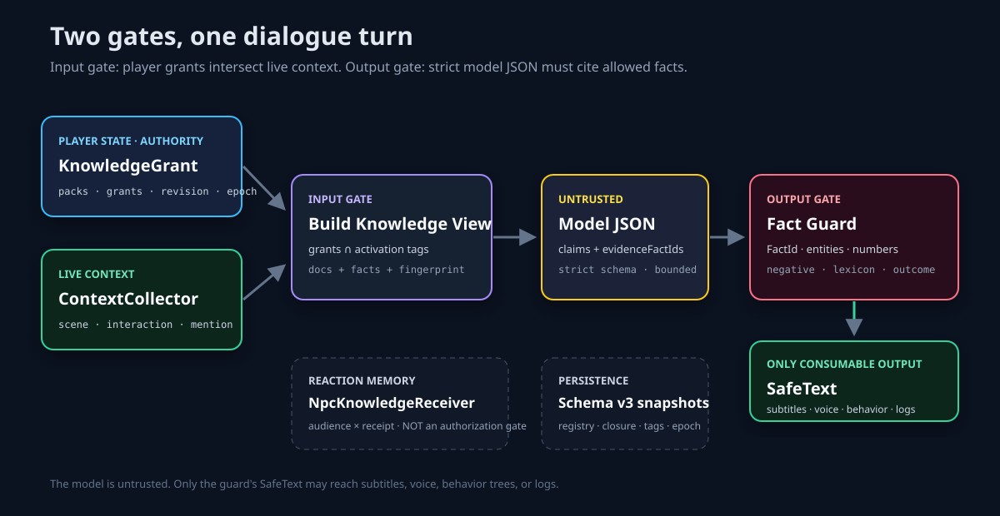
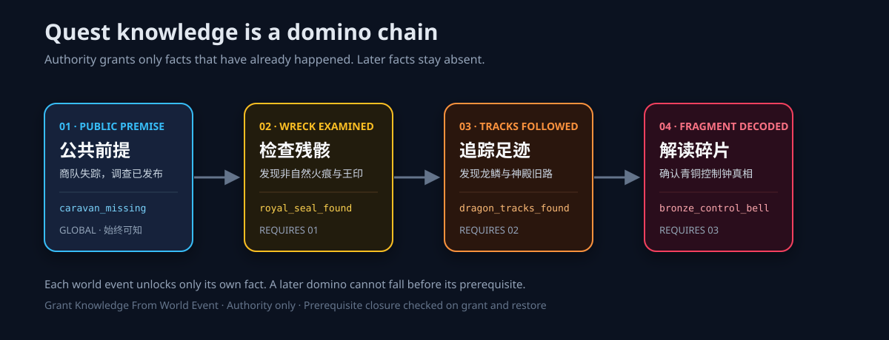

# My AI Town Knowledge Grant

**作者与版权人：xunyv**  
**许可证：Apache License 2.0**

面向 ARPG、开放世界 RPG，以及需要自行接入服务端持久化的联网 RPG 的 Unreal Engine Runtime 基础插件。它不是让 NPC 在任务前“一无所知”，而是把公共常识、已发生事件和未来剧情拆成独立知识包。玩家行动推倒第一块因果骨牌后，Authority 才能按世界事件逐包授予新事实；尚未发生的任务详情、道具和结果不会进入 AI 上下文。已发生事实再与 NPC 的稳定人格、当前情绪组合，形成确定性的台词语气和行为意图。本插件不是完整 MMORPG 后端。

## 一眼看懂



## 多米诺骨牌：未来事实如何解锁



任务知识不是一次性塞给模型，而是由玩家行动逐块推倒：

| 骨牌 | 触发 | 新增事实 | 前置 |
|---|---|---|---|
| 01 | 公共任务发布 | 北境商队失踪，调查已发布 | 无 |
| 02 | 玩家检查烧毁车辆 | 现场发现非自然火痕与拖拽痕迹 | 01 |
| 03 | 玩家追踪现场痕迹 | 发现龙鳞与神殿旧路 | 02 |
| 04 | 玩家解读青铜碎片 | 确认青铜碎片属于控制钟 | 03 |

```text
公共前提（始终可知）
   └─ 检查残骸 ──> 异常火痕 / 拖拽痕迹
          └─ 追踪足迹 ──> 龙鳞 / 神殿旧路
                 └─ 解读碎片 ──> 控制钟真相
```

规则只有三条：

1. **只有已经发生的事实才能被授予**；未来事件、道具和结果留在后续包里。
2. `Required Pack Ids` 不满足时，授予返回 `knowledge_prerequisite_missing`；乱序不会静默解锁。
3. 已授权资料还要通过当前场景/专名标记和输出证据门，才会进入 `SafeText`。

因此 NPC 可以知道“商队失踪、调查已发布”，但不会提前知道“龙鳞、异常痕迹或控制钟”。这不是让 NPC 失忆，而是让它的知识边界与玩家真实推倒的骨牌一致。

## 开源许可

本项目由 **xunyv** 以 [Apache License 2.0](LICENSE) 完全开源。允许个人和组织免费使用、复制、修改、分发及用于商业项目；再分发时须保留许可证与版权声明。商标、第三方资产及 Unreal Engine 本身不因本许可证获得授权，仍分别受其权利人的条款约束。

公开仓库应保留 `LICENSE` 与 `NOTICE`。欢迎提交 Issue 与 Pull Request；安全问题请避免公开披露敏感利用细节，并通过仓库维护者提供的私密联系方式报告。

## 安装

将 `MyAiTownKnowledgeGrant` 整个目录复制到 Unreal 项目的 `Plugins/` 下，重新生成项目文件并编译。插件依赖引擎内置的 `GameplayTags` 模块，不依赖模型 SDK、数据库或网络服务。

UE 5.7.4 / Win64 可直接使用本项目生成的 `0.2.1` Release 包；安装、宿主发布前检查与已知边界见 [INSTALL.md](INSTALL.md)，官方构建清单见 [RELEASE_MANIFEST.md](RELEASE_MANIFEST.md)。其他引擎版本或平台应使用源码重新编译。

单机 ARPG 推荐把 `Knowledge Grant Component` 挂在跨关卡可恢复的玩家 Actor 或 PlayerState 上；联机 ARPG/MMORPG 推荐挂在服务器权威且可复制的 PlayerState 上。不要挂在每个 NPC 上。

## 蓝图接入

1. 创建 `Knowledge Pack` Data Asset，填写唯一的 `Pack Id`，并在 `Source Quest Id` 与 `Source World Event Id` 中二选一。未来事实应拆到后续包，用 `Required Pack Ids` 串成因果链。
2. 已发生的世界事件调用 `Grant Knowledge From World Event`；最终任务结算仍可调用 `Grant Knowledge From Quest`。乱序触发会返回 `knowledge_prerequisite_missing`。
3. `Grant Event Id` 必须稳定且唯一，例如 `PlayerId:QuestId:CompletionRevision`。插件会裁剪首尾空白，并记录规范化的 `EventId → PackId`；同一事件换包会返回 `grant_event_id_conflict`。
4. 所有 NPC 的对话入口在组装 AI 上下文前调用 `Build Dialogue Knowledge View`，传入当前说话玩家的组件、候选知识包和当前语境标记。
5. 只在 Authority 侧把视图中的 `Allowed Documents` 交给后续提示词或 RAG 层。结果为空时不添加任何知识提示；非 Authority 客户端调用会得到 `authority_required`。
6. 每个 `Knowledge Document` 至少配置一个原子 `Knowledge Fact`，包含稳定 `Fact Id`、事实陈述、规范专名、规范数字和否定状态。模型必须输出下文定义的严格 JSON；把原始 JSON、同一个知识视图、实际 `Knowledge Context Collector` 组件和可信策略交给 `Guard Knowledge Model Json Response For Collectors`。该节点在内部读取当轮实时 Tags、完成解析与证据引用/元数据一致性检查，不向蓝图暴露未校验 claims。字幕、语音、行为系统和日志只能消费返回的 `Safe Text`。只有需要自定义语境来源时才使用带显式 `Current Active Context Tags` 的底层入口。

`FDialogueKnowledgeView` 是一次对话的唯一知识快照，包含语境标记、玩家授权修订号、授权世代、允许文档、排除原因和 CRC32 一致性校验值。输出门会把视图语境与调用方提供的当轮实时 Tags 做精确比较，并重新核对当前授权 Revision 与 `AuthorizationEpoch`。切场景、恢复/替换授权状态或改写视图后，分别以 `dialogue_view_context_changed`、`dialogue_view_stale` / `dialogue_view_authorization_changed`、`dialogue_view_tampered` 失败关闭。CRC32 只发现意外改写，不是密码学签名。

`FKnowledgeDialogueGuardResult::Outcome` 明确区分 `Invalid`、`Allowed`、`PartiallyAllowed` 和 `Blocked`。`bOk=true` 只表示至少有一条经过检查的事实陈述可用；全部陈述被拦时 `bOk=false`、`Outcome=Blocked`，可信兜底仍可通过 `SafeText` 返回。宿主应按 `Outcome` 分支，并且始终只消费 `SafeText`。

每条候选陈述都按知识性内容处理；候选结构中不再存在可由模型设置的 `bKnowledgeBearing=false` 旁路。安全兜底来自宿主预先创建的可信 `Knowledge Dialogue Guard Policy` 资产，调用方不能把原始候选文本临时作为兜底传入。策略还维护项目受保护专名/书写数字词表，用来发现文本中出现但 claim 元数据未申报的词。策略支持整段失败（默认 `AllOrNothing`）和逐条保留（`PerClaim`）。

## 场景与专属名词标记信息库

插件使用 UE 原生 Gameplay Tags。每个 `Knowledge Pack` 都可以填写 `Activation Tags`，例如：

- `Knowledge.Context.Scene.NorthGate`：北门场景库；
- `Knowledge.Context.Scene.Tavern`：酒馆场景库；
- `Knowledge.Context.Entity.RoyalCourt`：王廷专名库；
- `Knowledge.Context.Item.BronzeControlBell`：青铜控制钟专名库。

前四个示例标记由插件原生注册。项目可以在 Project Settings → Gameplay Tags 中继续添加城市、人物、阵营、道具、年代、组织等专属名词标记。

完整运行流程：

1. 为一组资料创建 `Knowledge Pack`，把资料写入 `Documents`。
2. 在 `Activation Tags` 填入能够激活这个信息库的场景或专名标记。空容器表示全局资料；填写多个标记时，当前语境匹配任意一个即可激活。
3. 任务完成或世界事件真实发生后，Authority 调用 `Grant Knowledge From Quest` / `Grant Knowledge From World Event`。标记只选择信息库，绝不代替任务授权。
4. NPC 对话开始时，宿主收集当前语境标记：所在 Scene/Volume、正在交互的 Actor、对话提到的专名、NPC 自身身份等，组合成 `Active Context Tags`。
5. 调用 `Build Dialogue Knowledge View`。插件生成：已授权知识包 ∩ 当前标记激活的信息库，并把本次作用域固化在视图中。
6. 把视图的 `Allowed Documents` 及其 `Facts` 送入模型；模型按原子陈述返回严格 JSON：`{"claims":[{"claimId":"...","text":"...","evidenceFactIds":["..."],"claimedEntities":["..."],"claimedNumbers":["..."],"negated":false}]}`。根对象和 claim 均禁止额外字段。
7. 调用 `Guard Knowledge Model Json Response For Collectors`，传入模型原始 JSON、同一个视图、实际收集器组件和宿主可信策略资产；插件内部从收集器读取当轮实时 Tags。空载荷、畸形 JSON、错误类型、空或重复 ID、超限数组与超长文本均失败关闭；只有内部解析并通过 `Guard Dialogue Knowledge View` 后才返回 `SafeText`。
8. 字幕、语音、行为树和后台日志只能消费返回的 `SafeText`。被锁定、属于错误场景或没有证据的陈述全部失败关闭。

最终可见知识公式：

`NPC 可说的信息 = 玩家已解锁资料 ∩ 当前场景/专名标记激活资料 ∩ 输出证据校验通过`

本插件采用“玩家授权 × 语境”模型。`Npc Knowledge Receiver Component` 只保存 NPC 收到消息后的确定性人格反应与情绪建议，不是知识授权门，也不参与上式；因此不会产生 `NPC × 玩家` 的知识副本。Reaction receipt 使用稳定 `AudienceId × ReceiptEventId` 隔离共享 NPC 面向不同玩家的反应记忆，但这些记录仍不授予任何事实。若项目确实要求每名 NPC 对每名玩家拥有独立事实记忆，应在宿主层另建有界记忆系统，而不能把 Receiver 的反应快照误当授权状态。

示例：北门和酒馆两个信息库都已经授权时，NPC 位于北门只得到北门资料；进入酒馆后切换为酒馆资料。若“北门密道”事件尚未发生，即使激活北门标记也不能读取密道资料。

这条链路与 GAS 的 `GiveAbility` 类似：任务系统授予玩家一个持久能力；区别是这里授予的是对话资料访问权。`BlueprintAuthorityOnly` 用于明确节点意图，运行时还会再次检查 Owner 是否具有 Authority。

### 关卡语境收集组件

把 `Knowledge Context Collector Component` 挂到玩家、PlayerState 或对话协调 Actor。它只选择当前相关的信息库，不授予知识：

1. Trigger Volume 的 `BeginOverlap` 调用 `Enter Scene Context`，以该 Volume 为 `Source` 并传入场景 Tags；`EndOverlap` 调用 `Exit Scene Context`。多个重叠 Volume 的 Tags 会合并，同一 Source 再次进入会替换自己的旧 Tags。
2. 开始交互时调用 `Set Interaction Context`，以交互 Actor 为 Source；切换目标会替换旧交互 Tags。结束交互调用 `Clear Interaction Context`，旧 Actor 的迟到清理事件不会清除新目标。
3. 对话适配器识别到明确专名后调用 `Set Explicit Mention Context`；每个对话轮次结束时调用 `Clear Explicit Mention Context`。
4. 模型调用前用 `Get Active Context Tags` 构建 `Build Dialogue Knowledge View`；模型返回后把同一个收集器组件交给 `Guard Knowledge Model Json Response For Collectors`，由插件内部重新读取实时 Tags。切场景、换交互对象或改变专名后，旧视图会被代码以 `dialogue_view_context_changed` 拒绝，宿主随后重新构建视图。收集器是输入门与输出门的共同事实源，调用方不再手写“当前 Tags”。

`Reset All Contexts` 用于关卡切换、玩家重生或对话会话强制结束。组件用弱引用跟踪来源；已销毁的 Volume/Actor 不会继续贡献 Tags。

## NPC 人格反应

1. 为 NPC 创建 `Npc Personality Profile` Data Asset，配置共情、好奇、谨慎、秩序忠诚和攻击性。这些是稳定人格，不会被一次消息永久改写。
2. 在知识文档中配置威胁、新闻性、道德侵犯、秩序影响和主题标签。
3. 给需要记住消息反应的 NPC 挂载 `Npc Knowledge Receiver Component` 并指定人格资产。
4. NPC 即将与玩家发生相关对话时，在 Authority 侧调用 `Receive Unlocked Knowledge Pack`。这是延迟接收：任务完成时不遍历全世界 NPC。
5. 节点返回兴趣、认可、感知威胁、反应强度、台词语气、行为意图，以及可选情绪系统可消费的有界建议量。

`FNpcAffectContext` 只接受当前心境和激活态的语义输入；插件本身不依赖 `AIaffect-core`。若项目已有情绪系统，可以把它映射到该输入，并自行消费 `SuggestedValenceDelta` / `SuggestedArousalDelta`。

## 存档与复制

- 组件状态自动复制，但授予和恢复只能在 Authority 上执行。
- 存档时调用 `Create Snapshot`，传入项目当前的稳定 `Pack Registry Version`，再把返回结构写入 SaveGame 或后端。
- 载入时在服务端调用 `Restore Snapshot`，同时传入当前注册的全部 `Knowledge Pack` 和期望的注册表版本。
- 当前知识快照 Schema 为 v3。恢复会拒绝旧 Schema、注册表版本不匹配、未注册包、缺失前置闭包、循环前置、伪造 Tags、无对应事件历史的已授予包，以及指向未授权包的事件记录；授权 Tags 会根据注册包重新派生。
- 恢复成功后 Revision 必定大于当前状态与快照中的 Revision，并生成新的 `AuthorizationEpoch`，因此恢复前的全部对话视图都会失效。
- v1/v2 快照不会静默迁移。项目若需要保留旧存档，应在宿主层显式迁移并重新生成 v3 快照。
- Receiver 反应快照为 Schema v3；每条 receipt 必须包含规范化的 `AudienceId`，反应分数、语气、行为意图和建议增量都必须落在插件定义范围。旧 v1/v2 快照失败关闭。恢复成功会广播 `On Reaction Memory Restored`，宿主可直接刷新表现。
- `ProcessedGrants` 保存规范化的 `GrantEventId → PackId`，防止重放和事件 ID 换包。
- 撤销使用 `Revoke Knowledge Pack`，需要传入当前注册包；会移除该包的授权与历史并重新派生 Tags。若仍有已授权包依赖它，返回 `pack_has_dependents`，必须先撤销依赖者。
- `Max Processed Grant Records` 与 Receiver 的 `Max Receipt Records` 默认 `0`（不限）；设置为正数时，超出上限返回 `grant_history_full` / `receipt_history_full`，失败关闭而不是静默丢弃历史。

## 验收

在 Unreal Automation 中运行：

- `MyAiTown.KnowledgeGrant.Runtime.QuestFlow`
- `MyAiTown.KnowledgeGrant.Runtime.Validation`
- `MyAiTown.KnowledgeGrant.Runtime.CausalChain`
- `MyAiTown.KnowledgeGrant.Runtime.DialogueGuard`
- `MyAiTown.KnowledgeGrant.Runtime.ModelAdapterContract`
- `MyAiTown.KnowledgeGrant.Runtime.SnapshotConsistency`
- `MyAiTown.KnowledgeGrant.Runtime.ContextTagLibraries`
- `MyAiTown.KnowledgeGrant.Runtime.ContextCollector`
- `MyAiTown.KnowledgeGrant.Reaction.PersonalityAndAffect`
- `MyAiTown.KnowledgeGrant.Reaction.DelayedReceipt`

自动化测试覆盖：公共任务常识可用但未来细节不可用、后续骨牌乱序拒绝、每次事件只新增当前事实、任务包兼容、事件幂等、事件 ID 换包冲突、注册表一致的快照恢复、跨版本/伪造/缺前置/循环/缺事件历史快照拒绝、无效但未授权注册包不阻塞恢复、语境隔离与 Collector 取实时 Tags、空证据拦截、整段/逐条策略、陈旧/篡改视图拒绝、错专名、漏报受保护专名、错数字、正负号与小数、中文书写数字、反转否定、畸形/越界模型 JSON、撤销依赖保护与可选历史上限，以及同一事实结合不同人格形成不同反应。Receiver 测试证明共享 NPC 可分别记录玩家 A/B 的同名事件、单个玩家内部仍幂等、非 Authority 拒绝、受众/事件 ID 规范化、事件换包冲突、伪造越界反应拒绝和可选 receipt 上限。宿主演示还验证清空后 HUD 不保留旧反应、恢复后从 Receiver 快照重建可见反应。宿主网络测试另以专用服务器和两个真实 PIE 客户端验证：玩家 A 的授权复制后不会出现在玩家 B，客户端直接授予与恢复均返回 `authority_required` 且不改变修订号。

本仓库包含插件的 10 项 Automation 测试。宿主演示 2 项与专用服务器/双客户端 PIE 1 项在独立 Demo 仓库验证；0.2.1 的跨仓库验证记录见 [VALIDATION.md](VALIDATION.md)。

没有 Unreal 工具链时可先运行 `node Scripts/validate-plugin.mjs`。它只验证插件结构和关键边界，不能替代 UnrealHeaderTool、C++ 编译或 Automation Test。

## 第一版边界

本插件决定“哪些资料允许进入对话上下文”，并对带事实证据引用的结构化候选台词做生成后检查；它不调用模型、不扫描项目文件、不管理 Token 预算、不实现向量检索。内置适配器只负责严格解析 JSON，并执行“证据引用与元数据一致性门”。它机械比较 `FactId`、规范专名、带符号小数、宿主声明的书写数字和有限否定短语，但不能证明开放域自然语言完整蕴含所引用事实：证据正确的文本仍可能夹带未登记断言，谓词偷换、隐喻、代词指代和词表外专名也不受完整语义证明。若项目要求这种保证，必须使用宿主控制的规范事实模板或独立语义验证服务。若宿主绕过统一 Guard，插件同样无法提供防泄漏保证。

本阶段故意移除了旧的 `Resolve All Unlocked Knowledge`、`Resolve Knowledge For Context Tags`、`Filter Grounded Dialogue` 和 `Filter Grounded Dialogue For Context Tags` 蓝图入口。这是一次失败关闭的破坏性 API 迁移：旧蓝图必须改为“构建视图 → 生成候选 → 守卫视图”，否则应在编译时暴露缺失节点，而不是静默绕过语境。

如果任务资料属于必须防止客户端提前读取的剧情秘密，不要把明文 Data Asset 烘焙进客户端包；应由服务器或受控后端保存正文。本插件的 Authority 门保护运行时解析链，不承诺对已随客户端发布的资产提供反拆包保密。

本插件不实现 MMORPG 所需的跨服授权账本、玩家换服加载、服务端正文分发、NPC 全局持久身份、撤销/迁移、运营审计或无限期去重历史压缩。`ProcessedGrants` 与 Receiver receipts 当前仍为无界数组。大型在线项目必须在宿主后端定义这些生命周期与容量策略，再把受控结果映射到本组件；不能把单个 UE ActorComponent 当作 MMO 权威数据库。


